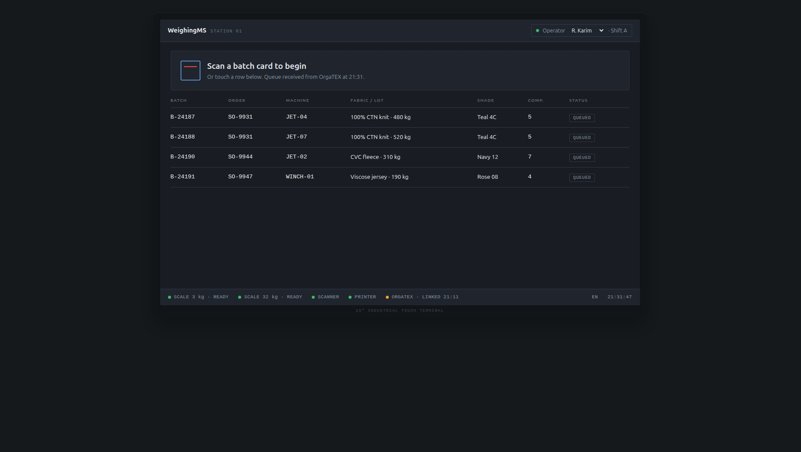
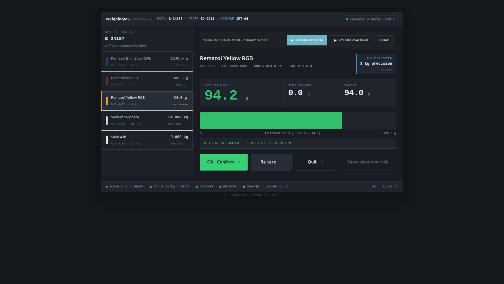
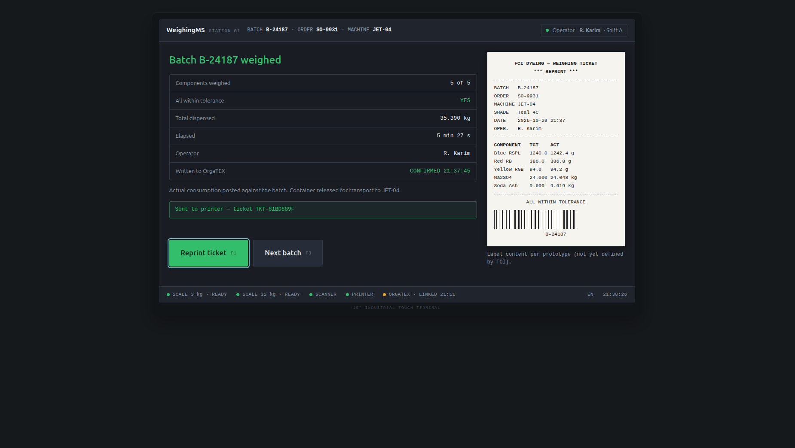
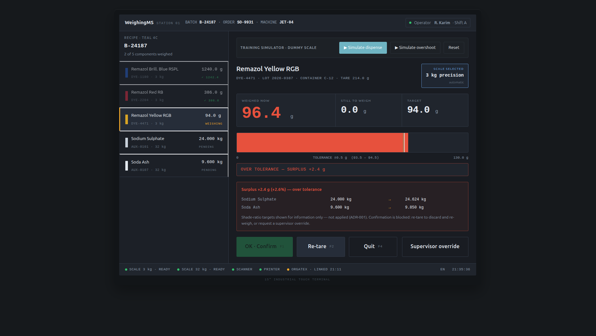
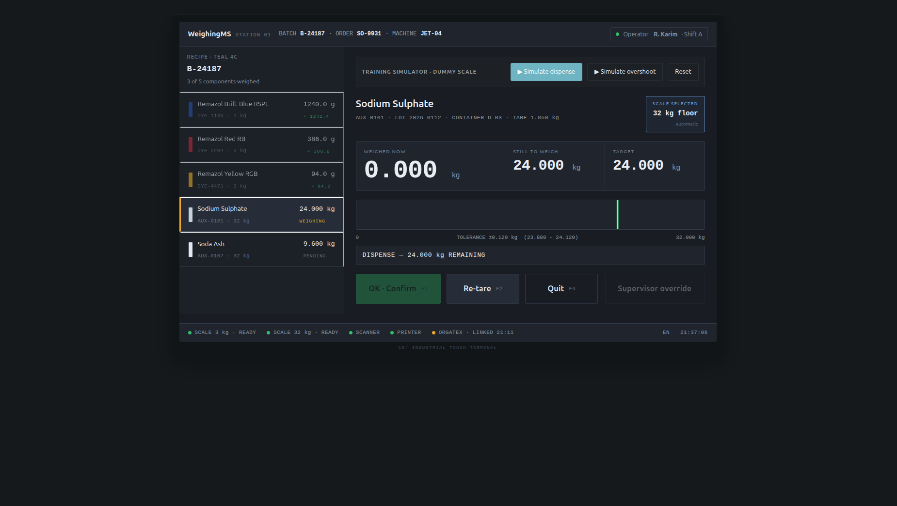
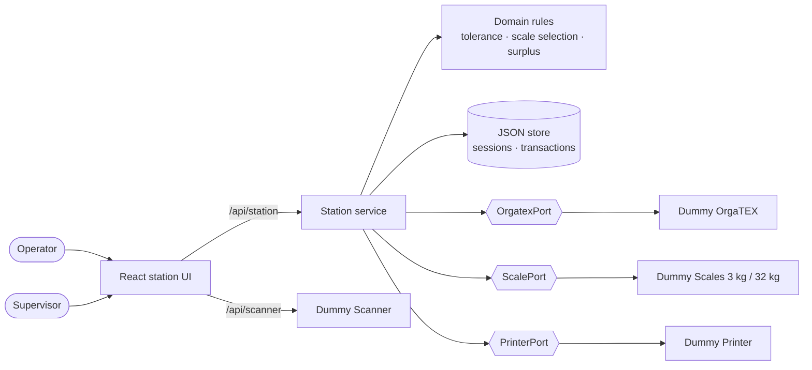

# WeighingMS

**Assisted dyestuff weighing station for textile dyehouses**, built with the **specs.md** AI-DLC methodology.

WeighingMS guides a weighing operator through every component of a dye recipe. It picks the correct scale automatically, shows the live weight against target and tolerance, refuses out-of-tolerance weighings, records full traceability, writes actual consumption back to the production system (OrgaTEX MES) and prints a weighing ticket.

    

> **Training build.** The real OrgaTEX, weighing scales, barcode scanner and ticket printer are not available, so each one is replaced by a **Dummy API** behind a replaceable port. Dummy endpoints are training contracts only. They make no claim about the real OrgaTEX interface.

---

## Contents

- [Features](#features)
- [Screens](#screens)
- [Quick start](#quick-start)
- [Demo walkthrough](#demo-walkthrough)
- [Architecture](#architecture)
- [API reference](#api-reference)
- [Business rules](#business-rules)
- [Testing](#testing)
- [AI-DLC artifacts](#ai-dlc-artifacts)
- [Project structure](#project-structure)
- [Known limitations](#known-limitations)

---

## Features

| Capability | Description |
|---|---|
| **Batch queue** | Batches released by OrgaTEX, selected by touch or barcode scan |
| **Recipe guidance** | Components shown in sequence, each marked done, active or pending |
| **Automatic scale selection** | Targets ≤ 3 kg use the **3 kg precision** scale (g); larger targets use the **32 kg floor** scale (kg). The threshold is configurable |
| **Live guided weighing** | Live weight, still-to-weigh and target, plus a progress bar with the tolerance band and target line |
| **Tolerance enforcement** | Inclusive ± band per component. **OK · Confirm** is enabled only inside tolerance, and the server re-validates |
| **Overshoot handling** | Surplus amount and %. Shade-ratio targets for the remaining components are shown for information only. The operator re-weighs, or a supervisor overrides with a mandatory reason |
| **Traceability** | Every weighing records batch, component, lot, container, tare, scale, target, actual, result, operator and timestamp |
| **OrgaTEX write-back** | Actual consumption is posted on batch completion. If OrgaTEX is down, records are kept and the write-back is marked *PENDING* with a retry |
| **Weighing ticket** | Ticket preview and print, with reprint marking |
| **Safe failure handling** | Defined behaviour when the scale, scanner, printer or OrgaTEX is offline |

## Screens

| 1 · Select batch | 2 · Weigh | 3 · Confirm & print |
|---|---|---|
|  |  |  |

| Overshoot (surplus panel) | Automatic scale switch (32 kg floor) |
|---|---|
|  |  |

The UI reproduces the supplied prototype [`docs/customize-weighing-station.html`](docs/customize-weighing-station.html).

## Quick start

**Requirements:** Node.js 18 or later (developed on Node 24) and npm.

```bash
git clone git@github.com:Tamanna-Tanni-bs23/WeighingMS.git
cd WeighingMS
npm install
npm run dev
```

Open **http://localhost:5180**. A single process serves the UI at `/` and every API under `/api`.

| Command | Purpose |
|---|---|
| `npm run dev` | Start the app (Express + Vite middleware, hot reload) |
| `npm run build` then `npm start` | Production build, served by Express |
| `npm test` | Unit and API tests (Vitest + Supertest) |
| `npx playwright install chromium` | One-time browser install for E2E tests |
| `npm run test:e2e` | Playwright end-to-end suite (HTML report in `playwright-report/`) |
| `npm run typecheck` | TypeScript strict check |
| `npm run reset-data` | Clear runtime records in `data/runtime/` so the demo starts fresh |

## Demo walkthrough

1. **Select batch:** touch **B-24187** (Order SO-9931 · JET-04 · Teal 4C).
2. **Weigh:** on each component, press **▶ Simulate dispense** in the *Training simulator* bar. When the reading turns green, press **OK · Confirm**.
   - Press **▶ Simulate overshoot** to see the surplus panel. Confirm stays blocked; press **Re-tare** to re-weigh, or use **Supervisor override**.
   - **Sodium Sulphate** switches automatically to the **32 kg floor** scale, and the units change to kg.
3. **Confirm & print:** check the summary and `Written to OrgaTEX — CONFIRMED`, then press **Print ticket** and **Next batch**.

To simulate failures, call the training control endpoints:

```bash
curl -X POST localhost:5180/api/_dummy/scales/scale-3kg/offline     # scale unavailable
curl -X POST localhost:5180/api/_dummy/orgatex/offline              # OrgaTEX unavailable
curl -X POST localhost:5180/api/_dummy/printer/offline              # printer unavailable
curl -X POST localhost:5180/api/_dummy/scanner/scan \
     -H 'Content-Type: application/json' -d '{"code":"B-24187"}'    # barcode scan
curl -X POST localhost:5180/api/_dummy/reset                        # back to seed state
```

## Architecture

The app is a modular monolith built as **ports and adapters**. The weighing domain is at the centre, and each external system is reached only through a port. Replacing a Dummy with a real integration changes only that adapter.



| Layer | Technology |
|---|---|
| Language | TypeScript (strict, `noUncheckedIndexedAccess`) |
| Backend | Node.js 24, Express 5, Zod validation |
| Frontend | React 19, Vite 8, plain CSS taken from the prototype |
| Persistence | JSON files with atomic writes (`data/runtime/`), behind repositories |
| Testing | Vitest, Supertest, Playwright |

## API reference

All endpoints return JSON. Errors use `{ "error": { "code", "message", "details?" } }`. Status codes: `400` validation, `404` unknown resource, `409` business-rule conflict, `503` device or OrgaTEX unavailable.

**Dummy OrgaTEX** (training contract)

| Method | Endpoint | Purpose |
|---|---|---|
| GET | `/api/batches` | Batch queue |
| GET | `/api/batches/:batchId` | Batch details |
| GET | `/api/batches/:batchId/recipe` | Recipe components |
| POST | `/api/batches/:batchId/consumption` | Receive actual consumption |

**Dummy devices**

| Method | Endpoint | Purpose |
|---|---|---|
| GET | `/api/scales` | Scale list |
| GET | `/api/scales/:scaleId/status` | Scale status |
| GET | `/api/scales/:scaleId/weight` | Live net weight |
| POST | `/api/scales/:scaleId/tare` | Zero the scale |
| GET | `/api/scanner/next` | Next scanned code (`204` if none) |
| POST | `/api/tickets` | Print a ticket (`201`) |

**WeighingMS station**

| Method | Endpoint | Purpose |
|---|---|---|
| GET / POST | `/api/station/session` | Current session / start a batch |
| POST | `/api/station/components/:id/activate` | Make a component active |
| GET | `/api/station/live` | Live reading, evaluation and surplus proposal |
| POST | `/api/station/confirm` | Confirm the weighing (`409 OUT_OF_TOLERANCE` if invalid) |
| POST | `/api/station/retare` · `/quit` · `/override` | Re-tare, abandon component, supervisor override |
| POST | `/api/station/complete` · `/writeback/retry` · `/ticket` | Complete batch, retry write-back, print ticket |
| GET | `/api/weighings?batchId=` | Weighing records |
| GET | `/api/health` | Device and integration status |

Training-only controls live under `/api/_dummy/*` and are not part of the product.

## Business rules

| Rule | Implementation |
|---|---|
| Scale selection: ≤ 3 kg → precision, > 3 kg → floor | `src/server/domain/scale-selection.ts` (threshold in `config.ts`) |
| Tolerance: inclusive `[target − tol, target + tol]`, compared in integer display steps (0.1 g / 0.001 kg) | `src/server/domain/tolerance.ts` |
| Example (Yellow RGB, 94.0 ± 0.5 g) | 93.4 ✗ · 93.5 ✓ · 94.0 ✓ · 94.5 ✓ · 94.6 ✗ |
| Overshoot: confirm blocked; re-weigh or supervisor override with reason; shade-ratio proposal shown but never applied | [ADR-001](memory-bank/bolts/004-weighing-station/adr-001-overshoot-surplus-handling.md) |
| OrgaTEX down at completion: records kept, write-back *PENDING*, manual retry | `src/server/application/station.ts` |

## Testing

```bash
npm test            # 42 unit + API tests
npm run test:e2e    # 11 Playwright tests
```

The end-to-end suite covers:
- the full **B-24187** workflow: 5 components → OrgaTEX write-back → ticket;
- the tolerance boundaries and the overshoot surplus panel;
- a supervisor override;
- these failure scenarios: scale, OrgaTEX and printer unavailable; re-tare; quit; incomplete batch.

Traceability from requirements to tests is in **[FINAL-EVIDENCE.md](FINAL-EVIDENCE.md)**. Supporting evidence (API transcripts, records, screenshots) is in [`evidence/`](evidence/), and the HTML report is in [`playwright-report/`](playwright-report/).

## AI-DLC artifacts

The project followed specs.md **AI-DLC**: Inception, then Construction, with human validation checkpoints.

| Artifact | Location |
|---|---|
| Standards (tech stack, architecture, API, UX, coding) | [`memory-bank/standards/`](memory-bank/standards/) |
| Intent and requirements (FR-1…FR-24, NFRs, assumptions, open questions) | [`memory-bank/intents/001-assisted-weighing-station/requirements.md`](memory-bank/intents/001-assisted-weighing-station/requirements.md) |
| UI/UX analysis of the prototype | [`ui-analysis.md`](memory-bank/intents/001-assisted-weighing-station/ui-analysis.md) |
| System context | [`system-context.md`](memory-bank/intents/001-assisted-weighing-station/system-context.md) |
| Units (4) and stories (22) | [`units/`](memory-bank/intents/001-assisted-weighing-station/units/) |
| Bolts (6) and ADRs | [`memory-bank/bolts/`](memory-bank/bolts/) |

Source material is in [`docs/`](docs/): the Business Requirements Document (`brief.md`), the UI prototype, and the project requirement.

## Project structure

```text
WeighingMS/
├── docs/                  Product brief, UI prototype, project requirement
├── memory-bank/           AI-DLC artifacts (standards, intents, units, stories, bolts)
├── src/
│   ├── shared/            API contract types (client + server)
│   ├── server/
│   │   ├── domain/        Pure rules: tolerance, scale selection, surplus
│   │   ├── application/   Station service (session, confirm, override, write-back, ticket)
│   │   ├── ports.ts       OrgatexPort, ScalePort, PrinterPort
│   │   ├── adapters/      Dummy adapters
│   │   ├── dummy/         Dummy OrgaTEX + devices, seed data
│   │   ├── app.ts         Express routes
│   │   └── index.ts       Server entry (single port)
│   └── client/            React UI
├── tests/e2e/             Playwright specs
├── evidence/              Evidence files and screenshots
├── playwright-report/     Latest E2E HTML report
└── FINAL-EVIDENCE.md      Requirement → test traceability matrix
```

## Known limitations

- The Dummy OrgaTEX, scale, scanner and printer contracts are **training contracts only**. Real interfaces depend on open questions in the brief (A-01, A-02, A-05).
- There is no real authentication. The operator is chosen from a list, and the supervisor is identified by a role flag.
- Full offline synchronisation is out of scope. Only the write-back retries manually.
- Dyestuff barcode verification warns on a mismatch but does not block weighing.
- ESLint, Prettier and structured logging (pino) from the coding standard are not yet installed.
