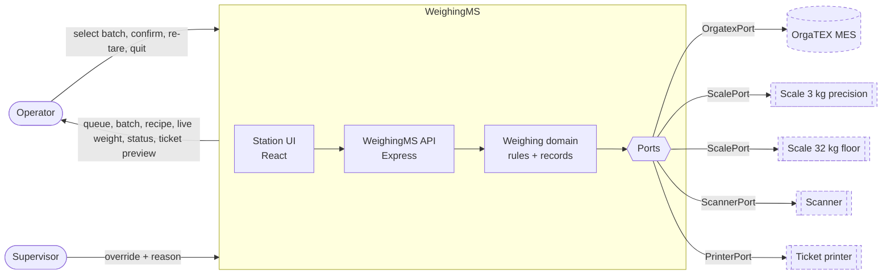

# Assisted Dyestuff Weighing Station - System Context

## System Overview

WeighingMS is the weighing-station application. It receives batches and recipes from OrgaTEX, guides the operator through weighing every component on the correct scale, records each weighing with full traceability, writes actual consumption back to OrgaTEX, and prints a ticket. OrgaTEX remains the owner of batches and recipes.

## Context Diagram

Dashed = **real conceptual system**. In this training build each is replaced by a **Dummy** implementation behind the same port:

| Real conceptual system | Training substitute | Port |
|------------------------|--------------------|------|
| OrgaTEX MES (SETEX) | Dummy OrgaTEX API (`/api/batches…`) | `OrgatexPort` |
| Scale 3 kg precision, Scale 32 kg floor | Dummy Scale API (`/api/scales…`) + pour simulator | `ScalePort` |
| Barcode scanner | Dummy Scanner (`/api/scanner…`) | `ScannerPort` |
| Ticket printer | Dummy Printer (`/api/tickets`) | `PrinterPort` |

## Actors

| Actor | Role |
|-------|------|
| Operator | Selects batch, weighs each component, confirms, re-tares, quits, prints ticket |
| Supervisor | Authorises out-of-tolerance acceptance (override) with a reason |

## Data Flows and Ownership

| Flow | Direction | Data | Owner |
|------|-----------|------|-------|
| Batch queue | OrgaTEX → WMS | batchId, order, machine, fabric, shade, component count, status | OrgaTEX |
| Recipe | OrgaTEX → WMS | components: id, code, name, target, unit, tolerance, lot, container, tare, sequence | OrgaTEX |
| Live weight | Scale → WMS | value, unit, stable?, timestamp, status | Scale |
| Tare | WMS → Scale | zero command | WMS (command), Scale (state) |
| Scan | Scanner → WMS | barcode string | Scanner |
| Weighing transaction | WMS internal | batch, component, lot, container, tare, scale, target, actual, result, operator, override, timestamp | **WeighingMS** |
| Consumption write-back | WMS → OrgaTEX | batchId, operator, completedAt, component actuals + lots | WMS sends; OrgaTEX stores |
| Ticket | WMS → Printer | ticket document | WMS composes; Printer prints |
| Config | WMS internal | scale threshold, scale definitions, operators | WeighingMS |

## External Integrations

- **OrgaTEX (Dummy)**: batch queue, batch details, recipe; accepts consumption posts. **Training contract only** — not a claim about the real interface (A-01, A-02).
- **Scales (Dummy)**: two scales with different capacity/units/precision; live weight, status, tare; controllable pour simulation (A-05).
- **Scanner (Dummy)**: delivers scanned codes (batch card, dyestuff) (A-10).
- **Printer (Dummy)**: accepts tickets, returns print ID (A-04).

## Integration Boundaries

- All external access goes through a **port** in the WeighingMS core; Dummy implementations are **adapters**. Replacing a Dummy with a real integration touches only its adapter (IR-07).
- Dummy APIs are hosted in the same process for training, under `/api/...`; the WeighingMS core calls them through adapters, never directly from the UI's business logic.
- Training-only control endpoints `/api/_dummy/*` (set weight, pour, offline/online, reset) are outside the product boundary.

## Failure Boundaries

| Failure | Detected at | Contained behaviour |
|---------|-------------|---------------------|
| OrgaTEX unavailable (queue/recipe) | OrgatexPort | Queue screen error + Retry; no partial batch loaded |
| OrgaTEX unavailable (write-back) | OrgatexPort | Records kept; write-back `PENDING` + Retry (D-3) |
| Scale offline | ScalePort | `SCALE OFFLINE`; Confirm disabled; nothing recorded |
| Invalid weight reading | Domain validation | Treated as error; Confirm disabled |
| Scanner offline | ScannerPort | Touch selection continues |
| Printer offline | PrinterPort | Ticket stays in preview, Retry; batch completion unaffected |

## High-Level Constraints

- Local single-process app, single origin, bound to 127.0.0.1 (standards).
- UI consumes data only via APIs; no scenario data in UI components.
- Reproduce prototype experience; do not copy its JS.

## Key NFR Goals

- Live weight refresh ≤ 250 ms; never slower than the operator (BO-06).
- No confirmed weighing lost; no invalid weighing recorded.
- Touch targets ≥ 15 mm; status by colour and text.
